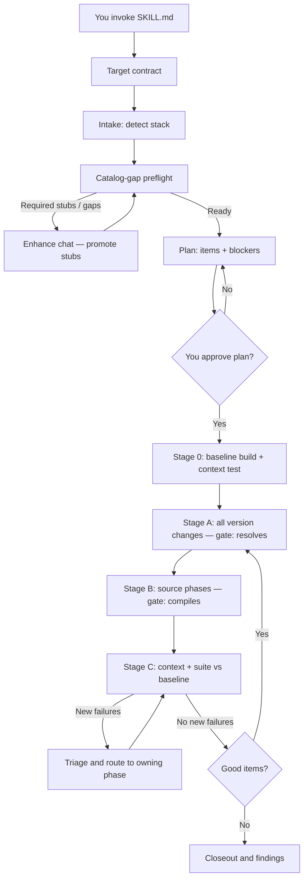
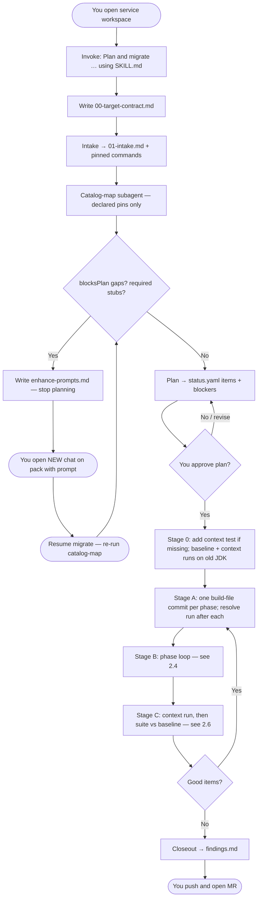
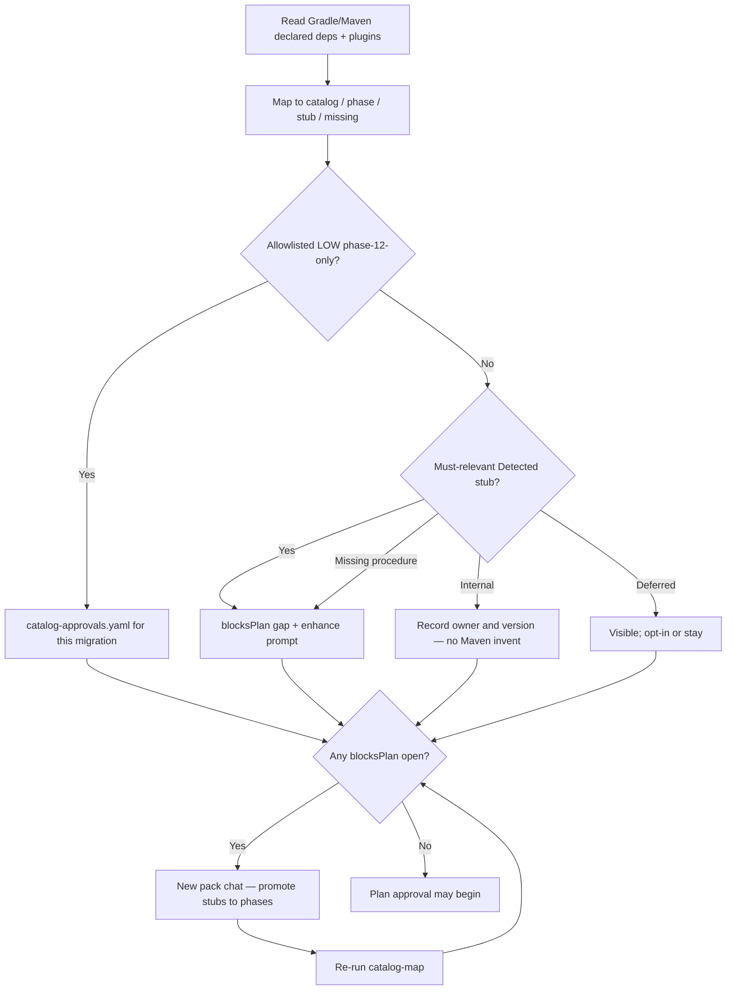
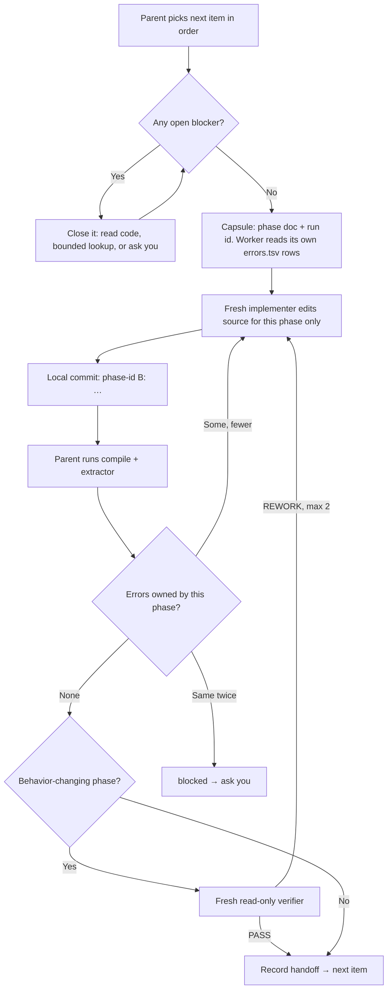
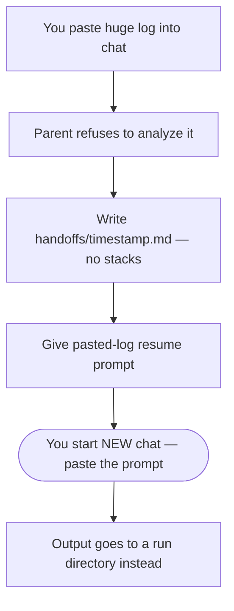
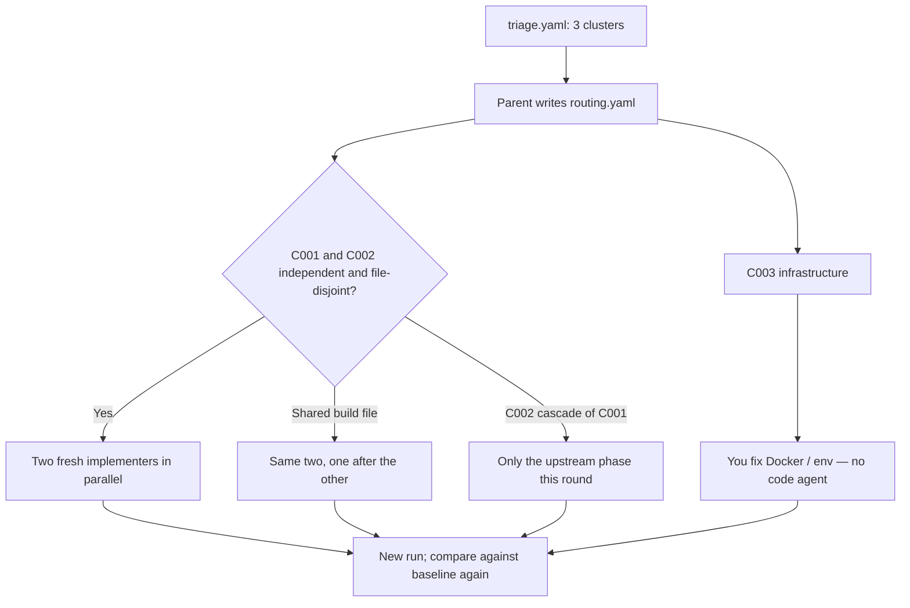
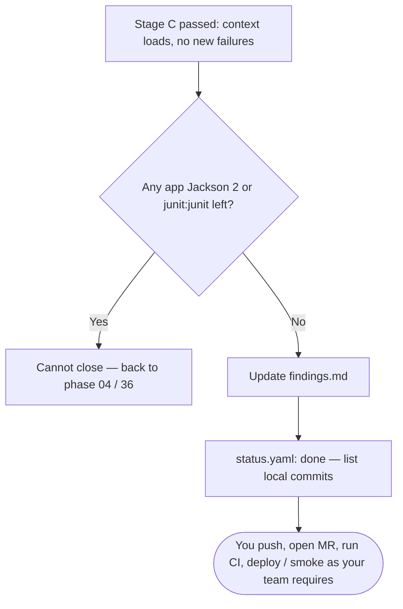

# Java-boot4-migration — User Manual

A guided, agent-driven workflow for moving a Java/Kotlin Spring service to **Spring Boot 4 + Java 25**.

You (the human) stay in control of decisions and pushes. The agent reads this pack, plans the migration, makes the changes phase by phase, runs the builds, and records everything in a local tracking folder. This manual explains how that works, how to drive it, and what to do when things go wrong.

> **Where to look for what**
>
> | You want to… | Read |
> |---|---|
> | Understand and operate the workflow | **This manual** |
> | See every phase and its execution order | [PHASE-CATALOG.md](references/PHASE-CATALOG.md) |
> | Know the exact rules the agent follows | [SKILL.md](SKILL.md) |
> | Add or improve phases in the pack | [CONTRIBUTING.md](CONTRIBUTING.md) and [AGENT.md](AGENT.md) |

---

## Contents

1. [How it works](#1-how-it-works)
2. [Sample end-to-end flow](#2-sample-end-to-end-flow)
   - [Actors](#21-who-appears-in-the-diagrams)
   - [Artifacts](#22-artifacts-touched-along-the-way)
   - [Start to closeout](#23-start-to-closeout)
   - [Catalog gap gate](#23b-catalog-gap-gate-detail)
   - [One phase](#24-one-phase-in-stage-b)
   - [Runs and logs](#25-runs-where-logs-go-and-who-reads-them)
   - [Stage C failures](#26-stage-c-many-failures-from-one-run-example)
   - [Chat reset](#27-chat-reset-triggers-when-the-parent-asks-for-a-new-chat)
   - [Finish line](#28-finish-line)
3. [Quick start](#3-quick-start)
4. [Navigating the pack](#4-navigating-the-pack)
5. [The migration lifecycle](#5-the-migration-lifecycle)
6. [Who does what](#6-who-does-what)
7. [Reading progress](#7-reading-progress)
8. [When things go wrong](#8-when-things-go-wrong)
9. [Resuming, pausing, and rolling back](#9-resuming-pausing-and-rolling-back)
10. [Prompt cookbook](#10-prompt-cookbook)
11. [FAQ](#11-faq)
12. [Improving the pack](#12-improving-the-pack)

---

## 1. How it works

The pack is a set of Markdown documents plus two small scripts. Nothing is installed and nothing runs on its own. When you point an agent chat at [SKILL.md](SKILL.md), the agent:

1. **Inspects** your service to see which technologies it uses (JPA, Kafka, WebFlux, Kotlin, GCP…).
2. **Selects** only the phases that apply and skips the rest.
3. **Plans** the work, ranking every item by priority, blast-radius risk, and execution gate, and listing the **blockers**: the questions that must be answered before the item can be written.
4. **Records a baseline**: a full build and a Spring context-load test on your current code, before any edit.
5. **Updates every dependency first** (Stage A), then **fixes source phase by phase** (Stage B), where each compile error belongs to exactly one phase.
6. **Runs the context test** (Stage C). You run the full suite, and the agent compares it with the baseline.
7. **Closes out** with a summary of what was done, deferred, and still risky.



### Core principles

- **One repository at a time.** The agent never opens sibling services to copy how they migrated.
- **Versions first, then source.** A half-migrated classpath breaks unrelated code, so no phase is expected to be green on its own. Every version moves in Stage A; source fixes follow in Stage B.
- **Each error has one owner.** The extractor assigns every compile error to a phase ([ownership.json](references/ownership.json)). A phase fixes its own errors and nothing else, which stops one bad fix from piling up workarounds in later phases.
- **The agent runs compile, dependency resolve, and the single context-load test** with Gradle or Maven, and writes the log under `.joker/`. You run the full test suite yourself, once at the start and once at the end. **CI** stays yours.
- **The agent never pushes.** It commits locally; you push and open the merge request.
- **No guessing.** An item with an open blocker is not started. A worker that hits a new unknown stops and reports it.
- **Clean Jackson 3 cutover.** No Jackson 2 bridge on Boot 4, not even temporarily.
- **Versions come from the catalog or migration-local approvals.** Declared deps are mapped after intake ([CATALOG-GAP.md](references/CATALOG-GAP.md)). Required stubs must become phases before planning. The migrate agent does not research pinned versions again or invent fleet catalog rows.

---

## 2. Sample end-to-end flow

Rules live in [SKILL.md](SKILL.md), [COMPILE-GATES.md](references/COMPILE-GATES.md), [CATALOG-GAP.md](references/CATALOG-GAP.md), [CONTEXT-CONTROL.md](references/CONTEXT-CONTROL.md), and [LOG-TRIAGE.md](references/LOG-TRIAGE.md).

### 2.1 Who appears in the diagrams

| Actor | Role |
|---|---|
| **You** | Approve the plan, answer human blockers, run the full test suite at the baseline and at Stage C, start new chats when asked, push / open MR |
| **Parent orchestrator** | Owns `status.yaml`; runs builds and the extractor; never reads `raw.log`; never implements phase code itself |
| **Catalog-map subagent** | Maps declared deps to catalog/phase/stub; suggests migration-local LOW autos |
| **Enhance agent** | Separate pack chat: promote stubs → phases, update fleet catalog |
| **Phase implementer** | Fresh subagent per slice; gets one phase doc and its owned errors; commits locally |
| **Independent verifier** | Fresh read-only subagent; checks phases that can change behavior while the build stays green |
| **Log triager** | Fresh read-only subagent for Stage C; clusters failing tests into root causes |

### 2.2 Artifacts touched along the way

```text
.joker/java-spring-migration/
  00-target-contract.md, 01-intake.md
  catalog-map.yaml / catalog-gaps.yaml / catalog-gaps.md
  catalog-approvals.yaml / enhance-prompts.md
  status.yaml                      ← the only state file: plan, blockers, runs, progress
  phase-notes/<phase-id>.md        ← per-phase handoff with labelled claims
  baseline/                        ← Stage 0 captures (JSON wire probes, Netty allocator)
  verifier/<phase-id>.md
  verification-runs/<run-id>/
    run.yaml, raw.log, exit-code.txt
    summary.json, errors.tsv, tests.tsv, delta.tsv   ← extractor
    triage.yaml, clusters/C00N.md, routing.yaml      ← Stage C only
  handoffs/<timestamp>.md          ← chat-reset resume note
  findings.md
```

### 2.3 Start to closeout



The agent asks for a new chat after each stage gate and on the other triggers in 2.7.

### 2.3b Catalog gap gate (detail)



### 2.4 One phase in Stage B



Errors owned by a phase that is already done reopen that phase. Errors that no rule claims are routed by the parent and logged in `findings.md` as an ownership gap. Gradle stops compiling tests while main code fails, so test-side phases (36, 28, 09, 25, 26, 27, 16) run last in Stage B.

### 2.5 Runs: where logs go and who reads them

Every build is a run directory. The parent writes `run.yaml`, runs the pinned command with output going to `raw.log`, writes `exit-code.txt`, and runs the extractor. It reads one line like:

```text
run=20261023T101500Z-compile-a1b2c3d kind=compile exit=1 build=FAILED compile=37 [04-jackson-3:22 03-hibernate-7:15]
```

Compile, resolve, and the context test are run by the agent, and the log stays in the run directory. The full suite is the block in [COMPILE-GATES.md](references/COMPILE-GATES.md#running-a-build): you run it in your terminal and reply `Verification run <run-id> is ready.` Never paste the log. The agent runs the extractor itself.

**Wrong path — large log pasted into chat.**



### 2.6 Stage C: many failures from one run (example)

The suite run shows 100 tests newly failing against the baseline. The log triager groups them into root causes:

| Cluster | Count | Owner | Action |
|---|---:|---|---|
| C001 | 62 | `04-jackson-3` | Fresh implementer with phase 04 + C001 |
| C002 | 31 | `03-hibernate-7` | Fresh implementer with phase 03 + C002 |
| C003 | 7 | none — Docker down | No code change; you are told once |



Tests that fail in the baseline too (`stillFailing`) are not migration work. Tests that existed in the baseline but no longer run (`missing`) must be explained, because silently undiscovered JUnit 4 tests look exactly like that.

### 2.7 Chat reset triggers (when the parent asks for a new chat)

| Trigger | What the parent does |
|---|---|
| Log pasted into chat | Refuse analysis → handoff → new-chat prompt |
| A stage gate passed (0, A, B, C) | Handoff → new-chat prompt |
| Four build runs done in this chat (resolve, compile, context, test, or pipeline) | Handoff → new-chat prompt. The next chat starts the fifth run |
| Two fix rounds on the same root cause | Handoff before a third attempt |
| Conflicting memories of the same file | Stop editing → handoff → new chat |

The handoff file is short: reason, stage, commit, the next action, and only the blockers for it. It never embeds a log.

### 2.8 Finish line



---

## 3. Quick start

### Prerequisites

- The service checked out locally, on a fresh branch.
- A **JDK 25** available on your machine (you do not need to make it your default), plus the JDK the service builds with today.
- The build working locally on the current code (Gradle or Maven), including network access to your artifact repositories.
- A clean working tree, so the agent's commits are easy to review.

### Step 1 — Open the service as your workspace

The chat's workspace must be the **service under migration**, not this pack.

### Step 2 — Invoke the orchestrator

```text
Plan and migrate this service to Java 25 / Spring Boot 4 using <path-to-pack>/SKILL.md
```

Optionally state your targets and deferrals up front to skip the first round of questions:

```text
Plan and migrate this service to Java 25 / Spring Boot 4 using <path-to-pack>/SKILL.md
Target: Boot 4.1.x, Java 25, Spring Cloud 2025.1.x
Defer: WireMock 4, Cucumber 8 until after the must tier
```

### Step 3 — Clear catalog gaps (if asked)

If the agent reports `waiting-catalog-gaps`, open a **new chat on the pack** and paste the prompt from `enhance-prompts.md`. Promote required stubs to phases. Then resume migrate and let it re-run the gap check. Planning does not start until that is clean.

### Step 4 — Review the plan

The agent writes the plan into `status.yaml` and shows it as a table: items in order, priority, risk, and open blockers. Push back on anything that looks wrong, too large, or too risky. Nothing changes in your code until you approve.

### Step 5 — Answer human blockers

Some blockers only you can answer (for example, "may the error body change from ProblemDetail to empty?"). The agent asks them when the item comes up, not all up front. Answer with specifics, or defer the item.

### Step 6 — Let it run the stages

You run the baseline suite once. The agent then runs resolve, compile, and the context test, and asks you for the full suite again at Stage C. Expect a new-chat request after each stage or four runs. Reply `Verification run <run-id> is ready` after a suite run.

### Step 7 — Good tier, then close out

If good items were approved, the same stages repeat for them. When everything passes, review the local commits, push, and open your merge request.

---

## 4. Navigating the pack

```text
README.md          this repository's public entry
MANUAL.md          operator guide (you are here)
CONTRIBUTING.md    how to add phases, catalog rows, and stubs
SKILL.md           orchestrator rules the agent follows
AGENT.md           how to extend the pack
references/PHASE-CATALOG.md
phases/            executable steps, one concern per file
stubs/             known topics not yet fully documented
references/        catalog, gates, ownership.json
scripts/           log extractor and Gradle init script
dashboard/         local status board
```

### Phases

Each `phases/NN-name.md` covers one migration concern (Hibernate 7, Jackson 3, Security 7…). Every phase has the same structure:

| Section | What it tells you |
|---|---|
| **Detect** | When the phase applies, and when it is skipped |
| **Before → After** | Concrete examples of what changes |
| **Steps** | What the agent does (build-file steps run in Stage A, source steps in Stage B) |
| **Do not** | Things that are forbidden even if they would "make it green" |
| **Risk** | The phase's execution gate: `SAFE_AUTO`, `ASK_HUMAN`, or `SPIKE_FIRST` |
| **Rollback** | How to undo just this phase |
| **Done when** | Exit criteria |
| **Handoff** | One-line summary the orchestrator records |

**Important:** the number in a filename is a **stable ID**, not the execution order. The execution order lives only in the **Order** column of [PHASE-CATALOG.md](references/PHASE-CATALOG.md). For example, phase `42-baseline` runs first, and phase `36-junit-jupiter` runs near the end of Stage B because it is a test-side phase.

**Conditional must:** some phases become `must` only when a condition holds (phase 15 with Pub/Sub and protobuf 3.x; phase 28 with legacy `mockwebserver`). Those rules are written once, in [PHASE-CATALOG.md](references/PHASE-CATALOG.md#conditional-priority-the-only-place-these-rules-live). Because every version moves together in Stage A, none of them needs special ordering or temporary jars.

### Execution gates

These values come from each phase's **Risk** section. They are separate from the plan item's blast-radius `risk` (`low`, `medium`, or `high`) and its `priority` (`must`, `good`, or `bad`).

| Level | Meaning for you |
|---|---|
| `SAFE_AUTO` | Mechanical; the agent proceeds once the item has no open blockers |
| `ASK_HUMAN` | The agent needs your decision before changing behavior |
| `SPIKE_FIRST` | Prove it on a small experiment before committing to the full change |

### Stubs

`stubs/*.md` cover topics the pack recognizes but has not fully documented (Mongo, Maven, containers…). Kafka is a phase ([44-spring-kafka-4.md](phases/44-spring-kafka-4.md)). If intake Detects a stub that is **must-relevant** for this service, planning waits until that stub is promoted to a full phase in a separate enhance chat ([CATALOG-GAP.md](references/CATALOG-GAP.md)).

### References

| File | Use it when… |
|---|---|
| [DEPENDENCY-CATALOG.md](references/DEPENDENCY-CATALOG.md) | You need to know or approve a target version |
| [CATALOG-GAP.md](references/CATALOG-GAP.md) | Declared deps, stub promotion before plan, migration-local autos |
| [COMPILE-GATES.md](references/COMPILE-GATES.md) | You want the build commands, the run procedure, or the stage gates |
| [ownership.json](references/ownership.json) | You want to know why an error was assigned to a phase |
| [99-anti-patterns.md](references/99-anti-patterns.md) | You want to know what the agent must never do |
| [MIGRATION-EVIDENCE.md](references/MIGRATION-EVIDENCE.md) | You hit a symptom and want a known cause and fix |
| [CONTEXT-CONTROL.md](references/CONTEXT-CONTROL.md) | You want the subagent, blocker, evidence, and verifier rules |
| [LOG-TRIAGE.md](references/LOG-TRIAGE.md) | You want to know how Stage C failures are clustered |

---

## 5. The migration lifecycle

### 0. Target contract

The agent records the target Boot, Java, and Spring Cloud versions, plus anything you've deferred, in `00-target-contract.md`.

### 1. Intake

The agent scans your service for signals (dependencies, imports, configuration) and decides which phases apply. It also records the four build commands it will use (baseline, context, resolve, compile) and the JDK the service builds with today. Output: `01-intake.md`. **No code changes happen here.**

### 1b. Catalog gap preflight

A catalog-map subagent reads **declared** Gradle/Maven pins and plugins (not the full transitive tree) and maps them to the catalog, phases, and stubs ([CATALOG-GAP.md](references/CATALOG-GAP.md)).

- **LOW, phase-12-only** targets may be auto-approved **for this migration** into `catalog-approvals.yaml` (not written into the fleet catalog by migrate).
- **Must-relevant stubs** and missing procedures that need a phase: the agent writes `enhance-prompts.md`, sets status `waiting-catalog-gaps`, and asks you to open a **new chat on the pack** to promote stubs → phases.
- Planning does **not** begin until a re-check shows no `blocksPlan` gaps.

### 2. Planning

Every applicable item is classified along these dimensions. Blast-radius `risk` is not the procedure gate.

| Dimension | Values | Example |
|---|---|---|
| Priority | `must` / `good` / `bad` | Hibernate 7 is `must`; Cucumber 8 is often `good`; WireMock 4 beta is `bad` |
| Risk | `low` / `medium` / `high` | Hibernate 7 is `must` but `high` blast radius |
| Execution gate | `SAFE_AUTO` / `ASK_HUMAN` / `SPIKE_FIRST` | Copied from the phase **Risk** section |
| Blockers | named questions, each `open` / `closed` / `deferred` | "Which enums cross an HTTP boundary?" |

A blocker says who can answer it: the repo (the agent reads the code), a bounded lookup in official docs, or you. An item is `ready` only when every blocker is closed or deferred. This replaces a confidence score: instead of the agent rating itself, it has to name what it does not know and get an answer before writing code.

The agent presents the plan and **waits for your approval**.

### 3. Stage 0 — baseline

Before any edit, the agent makes sure one test loads the Spring context. If the service has none it can run alone (some load the context only through Cucumber), it adds a small `MigrationContextLoadsTest` that copies the existing context setup ([42-baseline](phases/42-baseline.md)). Then it runs the full build and the context test on your current JDK. These results are the baseline everything later is compared against. Tests that already fail are shown to you once and are not migration work.

The same stage captures JSON wire samples for phase 04 and, for WebFlux services, the Netty allocator baseline for phase 35.

### 4. Stage A — dependency wave

Every version and coordinate change across all must phases lands here, one commit per phase (`04-jackson-3 A: …`). The gate is that the build configures and every classpath resolves. Compile is expected to fail at this point; that is normal.

### 5. Stage B — source phases

The agent compiles once and the extractor assigns each error to a phase. Phases run in order. Each gets a fresh subagent with its phase doc and only its own errors. After each phase the agent compiles again:

- no errors left for that phase → done;
- fewer errors → another pass;
- the same errors twice → `blocked`, and you are asked.

Each phase writes a short handoff with labelled claims:

| Label | Meaning |
|---|---|
| `observed` | Read from a file; the line is quoted |
| `run` | Proven by a named run |
| `unverified` | Needs a later run or a check the agent cannot do; collected for you at the end of Stage C |

A read-only **verifier** subagent checks phases that can change behavior while the build stays green (Jackson, Hibernate/JPA, Security, GCP, WebFlux, retry, locks, and Flyway/config/testing when they touched behavior). It quotes the lines it objects to. If it disagrees, a fresh implementer redoes the phase; you hear from it only when it needs a decision. Full rules: [CONTEXT-CONTROL.md](references/CONTEXT-CONTROL.md).

You can ask for an **over-engineer gate** ([23](phases/23-over-engineer-gate.md)) at any point: a critic pass that argues against unnecessary complexity. It only recommends.

### 6. Stage C — runtime

The agent runs the context test first. You then run the full suite with the same command as the baseline. The extractor compares the two: newly failing, fixed, missing, and added tests. A log-triage subagent groups new failures into root causes and the agent routes each to the owning phase ([LOG-TRIAGE.md](references/LOG-TRIAGE.md)). The must tier passes when the context loads, nothing is newly failing, and every missing test is explained. You also see the accumulated `unverified` claims at this point.

### 7. Good tier

The same stages repeat for approved `good` items.

### 8. Closeout

`findings.md` records what was done, what was deferred, residual risks, and the local commits. The migration **cannot** close while any application Jackson 2 usage, `junit:junit`, Vintage, or a service pin of JUnit Jupiter 5 / Platform 1.x remains. Tests resolve Boot-managed JUnit 6. `MigrationContextLoadsTest` stays unless you remove it; it is the fastest future check that the context still loads.

---

## 6. Who does what

| Activity | Agent | You |
|---|:---:|:---:|
| Detect stack, select phases | ✓ | Review |
| Map declared deps / catalog gaps | ✓ | Open enhance chat for required stub promotions |
| Write plan and blockers | ✓ | Approve the plan; answer human blockers |
| Record the baseline | ✓ | Review pre-existing failures |
| Edit code and build files | ✓ | Review diffs |
| Resolve, compile, and the context-load test | ✓ | |
| Full test suite, at the baseline and at Stage C | | ✓ |
| Label handoff claims | ✓ | |
| Independent verify (behavior-changing phases) | ✓ | Only if it is blocked on a decision |
| Cluster Stage C failures | ✓ | |
| Write a chat-reset handoff | ✓ | Start a new chat with the given prompt |
| Commit locally | ✓ | |
| Run CI | | ✓ |
| Decide behavior or API changes | Proposes | ✓ |
| Approve `proposed` MED/HIGH versions | Proposes | ✓ |
| Push, open merge request | | ✓ |
| Deploy and smoke-test in an environment | | ✓ |

The agent never pushes, never triggers CI, and never commits anything under `.joker/`.

---

## 7. Reading progress

All migration state lives in your service under `.joker/java-spring-migration/`. It is intentionally **local and uncommitted**. Add `.joker/` to your local `.gitignore` if needed, but do not commit that change.

### Status board (you, not the agent)

A local HTML board reads `.joker` and shows stages, work items, your questions, verifier, and compile counts. It lives only under the pack’s `dashboard/` folder. **Do not point a migrate chat at it.**

From the **service repo** (the one that contains `.joker/`):

```bash
python3 <path-to-pack>/dashboard/server.py --root .
```

Then open `http://127.0.0.1:8765/` in Chrome, Safari, or Firefox. The board polls every two seconds. It never writes `.joker` and never serves `raw.log`. Verification runs are listed newest first, with pass/fail, a one-line summary, and owning work items from compile error ownership or the run’s commit — not the log.

| File | Read it to… |
|---|---|
| `00-target-contract.md` | Confirm the agreed target versions |
| `01-intake.md` | See which technologies were detected |
| `catalog-gaps.md` / `catalog-gaps.yaml` | See blocking gaps before plan |
| `catalog-approvals.yaml` | See migration-local LOW autos |
| `enhance-prompts.md` | Copy-paste prompts for pack enhance chat(s) |
| `status.yaml` | **See the plan, the stage, open blockers, the latest runs, and every item's status.** Ask the agent for a table view |
| `phase-notes/<id>.md` | See what a phase changed, and which claims are observed vs still unverified |
| `verifier/<id>.md` | See a read-only verdict for a phase |
| `baseline/` | See the Stage 0 captures |
| `verification-runs/<run-id>/` | See one build's result: `summary.json`, `errors.tsv`, `delta.tsv` |
| `handoffs/<timestamp>.md` | See the short resume note before a requested new chat |
| `findings.md` | Review deferrals, residual risk, ownership gaps, and loose ends |
| `critic/*.md` | Read over-engineer gate reports |

### Item statuses

| Status | Meaning | Your move |
|---|---|---|
| `pending` | Not started | Nothing |
| `in_progress` | Being worked on | Wait |
| `done` | Phase complete and committed locally | Review the commit |
| `blocked` | An open blocker, an upstream fix, or the same errors twice | Read the blocker; answer, unblock, or defer |
| `deferred` | Intentionally postponed | Confirm the reason is acceptable |
| `n/a` | Not applicable to this service | Nothing |

---

## 8. When things go wrong

Failures are expected on a framework major upgrade. The workflow is built to localize them to a phase and keep each fix reviewable.

### 8.1 A phase reports `blocked`

Typical causes: a decision only you can make, an upstream library without a Boot 4–compatible release, the same owned errors after two passes, or a conflict with an anti-pattern.

1. Open `status.yaml` (the item's `blockers`) and `phase-notes/<phase-id>.md`.
2. Choose: answer the blocker, approve a version, defer the item, or provide upstream information.
3. Tell the agent your decision and ask it to resume.

If a library has no Boot 4–compatible release, that blocks the migration. The agent will not work around it with a compatibility bridge. Upgrade or replace the library, or defer the migration.

### 8.2 The agent keeps asking questions

Each question is a `human` blocker: something it could not answer from your code or the official docs. Speed it up by:

- answering with specifics rather than "do whatever is standard";
- explicitly deferring items you don't want to decide now.

Don't tell it to "just try." A guessed change in an early phase is what forces later phases to pile workarounds on top.

### 8.3 Stage A will not resolve

The extractor names the missing coordinate and, through `git blame`, the phase commit that introduced it. That phase gets a fix. A coordinate no phase claims becomes a catalog gap ([CATALOG-GAP.md](references/CATALOG-GAP.md)); the agent does not invent a version.

### 8.4 Stage B has hundreds of compile errors

That is normal right after Stage A. The extractor's summary groups them by owner, for example `[04-jackson-3:220 03-hibernate-7:85 36-junit-jupiter:40]`. Each phase sees only its own rows. Errors can fall in two ways:

- An upstream fix makes many downstream errors disappear. Gradle also skips test compilation while main fails, so test-side errors appear only once main compiles; that is why those phases run last.
- An error that no rule claims is routed by the agent and logged as an ownership gap. If you see the same unowned error in several migrations, add a rule to `ownership.json`.

**Red flags in a proposed fix — reject these**

- Disabling CSRF, TLS, Flyway migrations, or Secret Manager import to get green.
- Adding `spring-boot-jackson2` or reverting to Jackson 2.
- Keeping `junit:junit`, Vintage, or a Jupiter 5 / Platform 1.x pin for any reason. Boot 4.1.1 manages JUnit 6.0.3.
- Pinning a library ahead of or behind the Boot BOM without a reason.
- `--add-opens` or JVM flags without a captured failure.
- Deleting or `@Disabled`-ing tests without explanation.
- Editing another phase's files to make this phase's errors go away.
- Large rewrites unrelated to the error.

All of these are covered by [99-anti-patterns.md](references/99-anti-patterns.md). You can tell the agent: "That conflicts with the anti-patterns; propose another fix."

### 8.5 Compile is green, but behavior changed

The most dangerous failures are silent. Look closely at:

| Area | Symptom | Phase |
|---|---|---|
| JSON | Enum values or date formats changed on the wire | [04-jackson-3](phases/04-jackson-3.md) |
| Actuator | Metrics or `httpexchanges` endpoint missing | [22-actuator](phases/22-actuator.md) |
| WebFlux | CPU or throughput shifted | [35-webflux](phases/35-webflux.md) |
| GCP | Works with emulator, fails with real credentials | [34-spring-cloud-gcp](phases/34-spring-cloud-gcp.md) |
| Containers | JVM flags silently ignored | [stubs/jvm-containers.md](stubs/jvm-containers.md) |
| Kafka | Consumer group protocol or share consumers changed without a decision | [44-spring-kafka-4](phases/44-spring-kafka-4.md) |

A green compile is necessary but not sufficient. Agree with your team on how far verification must go before calling the migration complete: compile, tests, runtime smoke, and/or deployed environment.

### 8.6 Tests are flaky or depend on the environment

Integration suites that need Docker, emulators, VPN, or real cloud resources may fail for reasons unrelated to the migration. If they also failed in the baseline, they show as `stillFailing` and are not migration work. Otherwise the triager marks them as infrastructure, and the agent does not change production code to compensate. Verify them in CI or the appropriate environment.

### 8.7 The agent did something you didn't want

- **Wrong direction, not committed yet:** say so and ask it to revert its uncommitted changes.
- **Already committed:** each commit carries one phase id, so you can revert it with `git revert <sha>` (or ask the agent to). Then update the plan or decision and let it redo the phase.
- **Scope creep:** point at the plan, or ask for an over-engineer gate pass ([23](phases/23-over-engineer-gate.md)).

### 8.8 A required library or upstream artifact isn't ready

If your service consumes internal libraries that must be migrated first, the service migration is blocked until those publish compatible versions. Give the agent the approved upstream versions. It will not inspect other repositories on its own.

### 8.9 You pasted a large log into chat (or the agent asks for a new chat)

Do not expect the agent to analyze a pasted log. It should:

1. refuse to dig into that paste;
2. write a short handoff under `.joker/java-spring-migration/handoffs/`;
3. give you a **copy-paste prompt** and ask you to start a **new** chat.

The same reset happens after each stage gate, after four build runs in one thread, after two fix rounds on the same cause, or when the agent detects conflicting file memory. Full triggers: [CONTEXT-CONTROL.md](references/CONTEXT-CONTROL.md#chat-reset--new-chat-handoff).

---

## 9. Resuming, pausing, and rolling back

### Resuming in a new chat

All state is in `.joker/java-spring-migration/`. Prefer the latest handoff file when the previous chat asked you to reset:

```text
Resume the Boot 4 migration using <path-to-pack>/SKILL.md.
Read .joker/java-spring-migration/status.yaml and the latest file under
.joker/java-spring-migration/handoffs/. Do not rely on prior chat history.
```

If the reset was because of a pasted log, add:

```text
A log was pasted earlier by mistake — ignore chat history for logs.
```

### Pausing

You can stop at any time. Committed phases stay committed locally; `status.yaml` shows what remains.

### Rolling back

| Scope | How |
|---|---|
| One phase | `git revert` that phase's commits (its `A:`, `B:`, and `fix:` commits); see the phase's **Rollback** section |
| The whole migration | Reset to `baselineCommit` in `status.yaml`, or abandon the migration branch (nothing was pushed by the agent) |
| JSON only | Not supported; Jackson 3 is part of the Boot 4 cutover |

Reverting a single Stage A commit in the middle of a migration usually leaves a mixed classpath. Prefer reverting the phase's A and B commits together.

---

## 10. Prompt cookbook

| Goal | Say |
|---|---|
| Start | `Plan and migrate this service to Java 25 / Spring Boot 4 using <path-to-pack>/SKILL.md` |
| After catalog gaps | Open a **new** chat on the pack; paste `enhance-prompts.md` (or the batch prompt the agent gave you) |
| Resume after enhance | `Resume using SKILL.md. Re-run catalog-gap preflight. Plan only if no blocksPlan gaps remain.` |
| Check status | `Show status.yaml as a table: stage, done, blocked, open blockers, waiting on me.` |
| Report a build you ran | `Verification run <run-id> is ready.` |
| Why this owner? | `Which ownership.json rule assigned <error> to <phase>?` |
| Defer an item | `Defer 16-cucumber-8 to a later MR; record it in findings.md.` |
| Approve a version | `Approve the catalog target for <coordinate> for this migration.` |
| Ask for a critic | `Run the over-engineer gate on the changes so far.` |
| Reject a fix | `That conflicts with 99-anti-patterns. Propose an alternative.` |
| Resume | `Resume using SKILL.md. Read status.yaml and the latest handoffs/ file. Do not rely on prior chat history.` |
| After a pasted log | Use the pasted-log resume prompt the agent wrote; do not paste the log again. |
| Close out | `Do the closeout: update findings.md and list local commits for my MR.` |

---

## 11. FAQ

**Why does the agent run the builds instead of me?**
The agent runs compile, resolve, and the context test, so those do not wait on you. You run the full suite twice, at the baseline and at Stage C, and you run CI. The agent reads only the extractor's one-line summary.

**Why not keep every phase green as it goes?**
Because half-migrated dependencies break code that has nothing to do with the current phase. Moving every version first, then letting each phase fix only its own errors, means a phase is never blamed for, or tempted to patch around, another phase's breakage.

**What replaced the 90% confidence score?**
Blockers. A self-rated score did not stop low-quality guesses. A blocker is a specific question that has to be answered by the code, the docs, or you before the item starts, and a worker that hits a new unknown must stop and report it.

**Will the verifier ask me after every phase?**
No. It runs only for phases that can change behavior while the build stays green, and rework stays between agents. You hear from it only when it needs a decision.

**Why did it add a `MigrationContextLoadsTest`?**
Some services load the Spring context only through Cucumber or a large suite. One small test that loads the same context gives a fast, repeatable check in the baseline and in Stage C. It stays after the migration unless you remove it.

**What if I already pasted a huge log into chat?**
The agent should stop, write a handoff, and ask you to start a new chat with a prompt it provides. Do not continue fixing in that polluted thread.

**Why does the agent ask for a new chat even when nothing failed?**
Long threads lose focus. After each stage or four build runs, a short on-disk handoff plus a fresh chat is cheaper than carrying every prior summary in context.

**Why is planning blocked on stubs?**
A stub is incomplete by design. If this service Detects a must-relevant stub, promote it to a full phase in a pack enhance chat first ([CATALOG-GAP.md](references/CATALOG-GAP.md)). That keeps migrate from improvising.

**Does the agent auto-update the shared dependency catalog?**
No. It may record allowlisted LOW phase-12-only targets in `.joker/catalog-approvals.yaml` for this migration only. Fleet catalog edits are enhance-agent work.

**Can I skip the plan review?**
You can approve quickly, but the agent still waits for your OK. The plan is your best chance to catch wrong assumptions.

**Can I run Boot 4 with Jackson 2 for a while?**
Not with this pack. Jackson 3 lands with Boot 4. To protect consumers, the pack captures your current JSON output in Stage 0 and proves the Jackson 3 output matches (or that differences are intentional).

**Why won't it look at another service that already migrated?**
Copying from another repository spreads its mistakes and service-specific decisions. Shared knowledge belongs in the pack's phases, catalog, and evidence ledger.

**What if my stack is only covered by a stub?**
Expect more blockers. The agent may ask you to approve a small spike. If the topic recurs, improve the stub using [AGENT.md](AGENT.md).

**Is `.joker/` safe to delete?**
Yes, after closeout. It's local tracking only. Deleting it mid-migration loses the agent's plan, baseline, and status.

**Can several repos migrate at once?**
Yes, as separate migrations, one chat per repo. Give each chat the upstream versions it must wait for. It will not open the other repositories.

---

## 12. Improving the pack

The pack gets better when those lessons land back here. [CONTRIBUTING.md](CONTRIBUTING.md) is the list: catalog rows, new phases, stub promotions, ownership rules, and evidence entries.

- **Found a reusable failure and verified fix?** Note it in `findings.md`, then add it to [MIGRATION-EVIDENCE.md](references/MIGRATION-EVIDENCE.md) through an enhancement pass.
- **An error kept landing as unowned?** Add a rule to [ownership.json](references/ownership.json).
- **A stub was not enough?** Expand it or promote it to a phase.
- **New library version approved?** Update [DEPENDENCY-CATALOG.md](references/DEPENDENCY-CATALOG.md).

Use a separate chat for pack maintenance, and don't edit the pack in the middle of a service migration:

```text
Using <path-to-pack>/AGENT.md, add a phase for <topic>. Wire it into PHASE-CATALOG. Do not migrate any service.
```

All new content must stay generic: no service names, internal hostnames, ticket IDs, or secrets.
